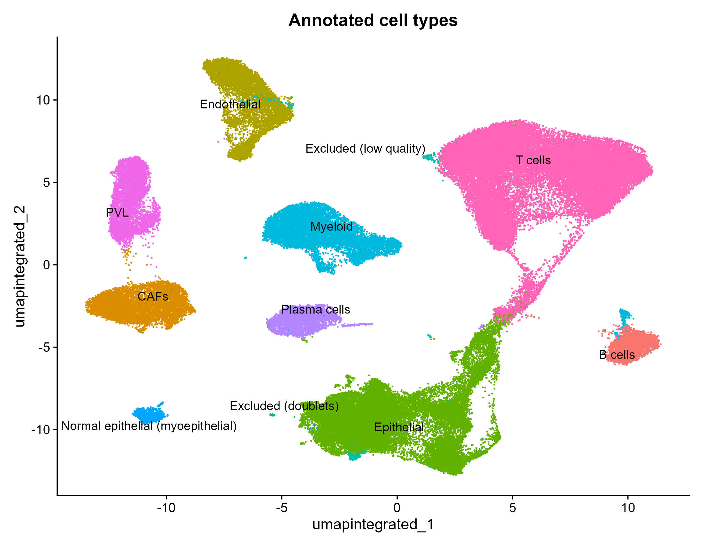
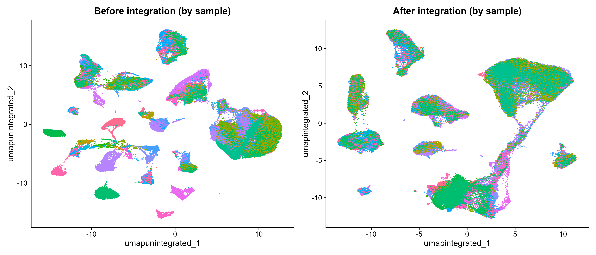
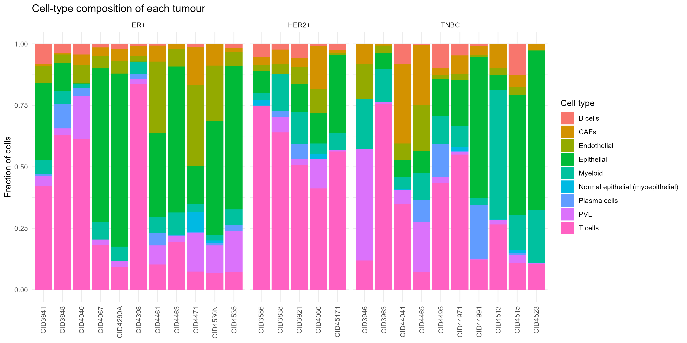

# Single-cell reanalysis of a breast cancer atlas

Reanalysis of the Wu et al. (2021) single-cell RNA-seq atlas of 26 primary breast tumours (GEO: [GSE176078](https://www.ncbi.nlm.nih.gov/geo/query/acc.cgi?acc=GSE176078)), built end to end in R with Seurat. The pipeline covers QC, integration, clustering and independent marker-based annotation, followed by a comparison of tumour microenvironment composition across breast cancer subtypes.

## Key results

- **98,593 cells** from 26 tumours (11 ER+, 5 HER2+, 10 TNBC) after QC and doublet removal.
- **29 clusters** annotated into 9 major cell types using canonical marker genes.
- **Independent annotation agreed with the authors' published labels for 92–100% of cells** in every major lineage.
- **No cell type differed significantly in abundance between subtypes after FDR correction** (n = 26 tumours).
- **Exploratory:** HER2+ tumours had consistently T-cell-dominated immune compartments (~85% of immune cells), whereas TNBC tumours split into T-cell-rich and T-cell-poor groups, the latter enriched for myeloid and plasma cells.



## Pipeline

| Step | Script | What it does |
| --- | --- | --- |
| 1. QC | `scripts/01_qc_filtering.R` | Filters cells (200–6,000 genes, < 20% mitochondrial reads); removes doublets with scDblFinder, run per sample |
| 2. Integration | `scripts/02_integration.R` | Log-normalisation, 2,000 variable genes, PCA (30 PCs), Harmony integration across patients |
| 3. Clustering | `scripts/03_clustering.R` | Graph-based clustering at resolutions 0.4–1.0; 0.8 chosen using clustree; marker genes per cluster |
| 4. Annotation | `scripts/04_annotation.R` | Marker-based cell-type labels, validated against published labels |
| 5. Composition | `scripts/05_compositional_analysis.R` | Cell-type fractions per tumour, compared across subtypes (Kruskal–Wallis, BH correction) |

## Methods in brief

**QC.** Cells were kept if they expressed 200–6,000 genes and had < 20% mitochondrial reads; genes were kept if detected in ≥ 3 cells. Doublets were removed with scDblFinder, run separately for each sample.

**Integration.** Each sample was log-normalised, and PCA (30 components) was computed on the 2,000 most variable genes. Harmony was used to correct for patient-level batch effects (CCA integration was tested first but was computationally impractical at this scale).



**Clustering.** A nearest-neighbour graph was built on Harmony dimensions 1–30. Resolutions 0.4–1.0 were compared with clustree; 0.8 (29 clusters) was the highest resolution at which major clusters remained stable.

**Annotation.** Clusters were labelled using canonical markers (EPCAM/KRT19, PTPRC, CD3E, MS4A1, MZB1/JCHAIN, CD68, PECAM1, COL1A1, RGS5/ACTA2, MKI67). Ambiguous clusters were resolved with a second marker panel and comparison to the published labels. Two small clusters were excluded: one with mixed, low-quality profiles and one co-expressing epithelial and perivascular markers (likely residual doublets).

| Cell type | Agreement with published labels |
| --- | --- |
| T cells | 100% |
| Endothelial | 99% |
| Myeloid | 99% |
| Epithelial (cancer + normal) | 99% |
| B cells | 97% |
| Plasma cells | 96% |
| PVL | 95% |
| CAFs | 92% |

**Compositional analysis.** For each tumour, the fraction of cells in each cell type was calculated (absent cell types counted as 0). Fractions were compared across ER+, HER2+ and TNBC with Kruskal–Wallis tests and Benjamini–Hochberg correction. Because epithelial capture varied widely between tumours, an exploratory second analysis expressed immune cell types as a fraction of immune cells only.





## Limitations

- **Small sample size:** 26 tumours, only 5 HER2+, giving limited power for subtype comparisons.
- **Dissociation bias:** several tumours contain almost no epithelial cells, so fractions reflect cells captured rather than true tumour composition.
- **Compositional data:** cell-type fractions sum to 1 and are not independent; a dedicated method such as `speckle::propeller` would be more rigorous.
- **Exploratory analyses:** the immune-compartment comparison was an additional analysis and should be treated as hypothesis-generating.
- **Pre-filtered input:** the GEO count matrix appears to have been quality-filtered by the original authors.
- **Malignant vs normal epithelial cells** were not separated by markers; this would require copy-number inference (e.g. inferCNV).

## Possible extensions

- Re-test subtype differences with `speckle::propeller`.
- Sub-cluster T cells and myeloid cells (e.g. regulatory T cells, macrophage states).
- Separate malignant from normal epithelial cells with inferCNV.

## Reproducing the analysis

1. Download the single-cell data for GSE176078 from GEO and place the count matrix, gene list, barcodes and `metadata.csv` in `data/raw/` (file names as read in `scripts/01_qc_filtering.R`).
2. Run the scripts in order, from the project root:

```r
source("scripts/01_qc_filtering.R")
source("scripts/02_integration.R")
source("scripts/03_clustering.R")
source("scripts/04_annotation.R")
source("scripts/05_compositional_analysis.R")
```

Main packages: Seurat (v5), harmony, scDblFinder, clustree, tidyverse, here.

```
├── data/          # raw and intermediate data (not tracked)
├── scripts/       # analysis scripts, run in order
├── results/       # tables (markers, compositions, test results)
└── figures/       # plots
```

## Reference

Wu SZ, et al. A single-cell and spatially resolved atlas of human breast cancers. *Nature Genetics* (2021). GEO: GSE176078.

## Author

Mahnoor Shahid — MSc Health Genomics, University of Essex
